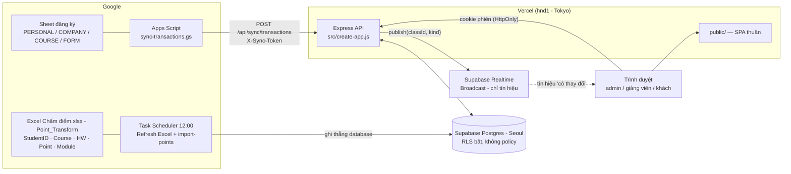
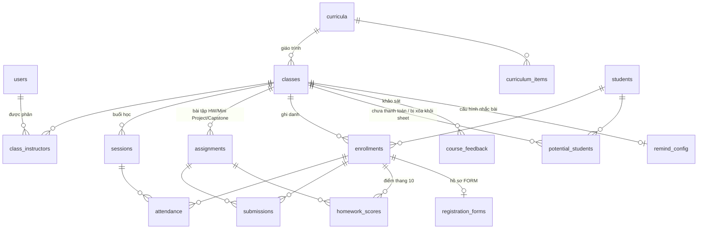
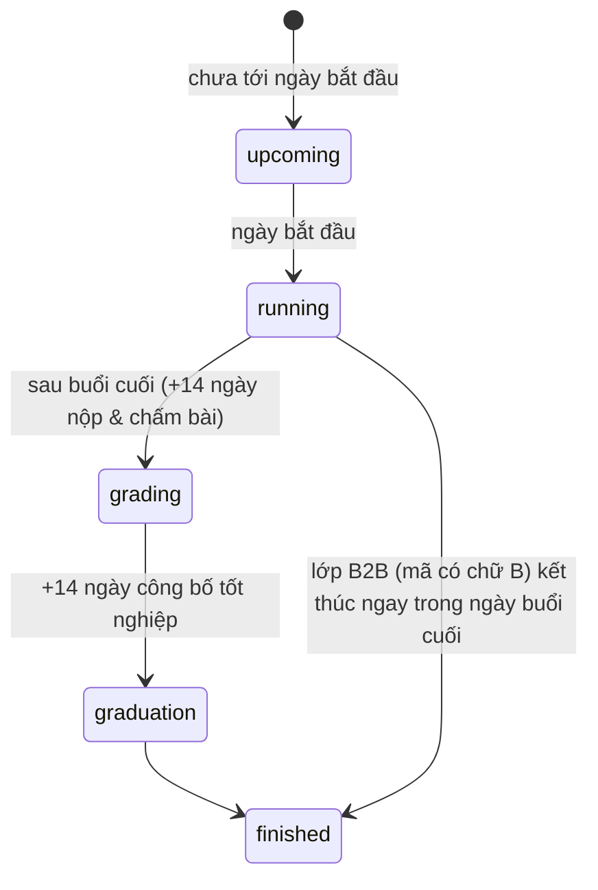
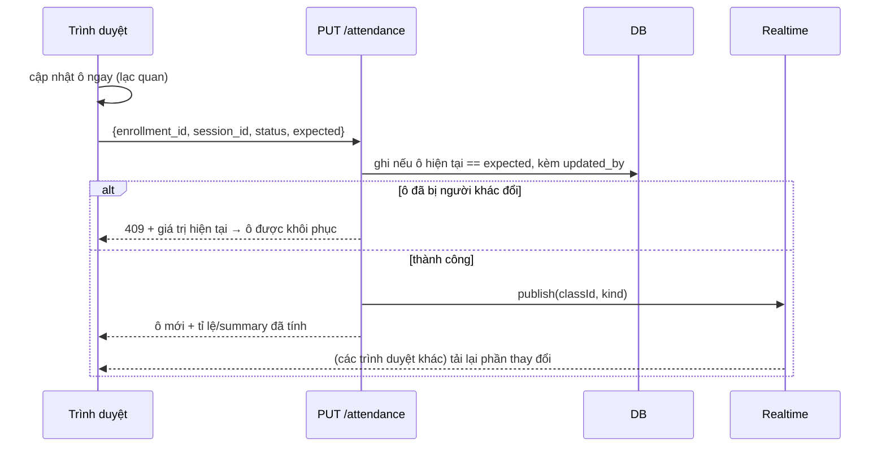
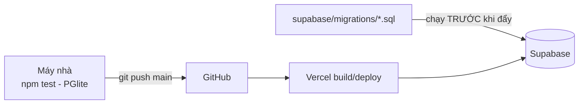

# DESIGN — Class Manager (Starttrain)

Tài liệu thiết kế của webapp quản lý lớp học: **vì sao** hệ thống được dựng như vậy, dữ liệu chảy thế nào, quy tắc nào là bất biến.
Cập nhật theo trạng thái ngày **18/10/2026** (173 test). Chi tiết cài đặt từng phần xem [Documents/3-ky-thuat/code-guide.md](Documents/3-ky-thuat/code-guide.md); nhật ký quyết định theo ngày xem [memory.md](memory.md).

---

## 1. Mục tiêu và phạm vi

**Bài toán.** Starttrain vận hành hơn 120 lớp (EBA, BIE, BIH, PBM, DDM, SCA, SQL…), khoảng 3.100 ghi danh, nhiều giảng viên. Trước đây điểm danh, bài tập, danh sách tốt nghiệp nằm rải rác trong các file Excel/Google Sheet.

**Mục tiêu.**
1. Một nơi duy nhất để **điểm danh, theo dõi bài tập, điểm, tốt nghiệp** theo từng lớp, nhiều người dùng cùng lúc.
2. **Tự động hóa** dữ liệu đăng ký từ Google Sheet của bộ phận vận hành (không nhập tay lại).
3. Cảnh báo sớm học viên cần chú ý; hỗ trợ giảng viên nhắc bài hàng loạt.
4. **Không bao giờ giữ số tiền** của học viên (ràng buộc của chủ dự án).

**Ngoài phạm vi.** Thanh toán/học phí, tạo nội dung bài giảng, cổng thông tin cho học viên (học viên không có tài khoản).

**Người dùng.** Admin (chủ dự án), giảng viên (xem/ghi theo lớp được phân), khách (chỉ xem).

---

## 2. Nguyên tắc thiết kế

| # | Nguyên tắc | Hệ quả cụ thể |
|---|---|---|
| P1 | **Một nguồn sự thật cho mỗi công thức** | Mọi tỉ lệ/điểm trung bình chỉ tính ở `src/services/stats.js`; frontend và route không tự tính lại |
| P2 | **Dữ liệu tiền không tồn tại trong hệ thống** | Bộ nhập chỉ đọc cột trong danh sách cho phép (`ALLOWED_*`), không "đọc hết rồi bỏ"; test kiểm có chuỗi tiền không lọt vào DB |
| P3 | **Server là nơi duy nhất quyết định quyền** | Ẩn nút ở giao diện chỉ để tiện; mọi route đều kiểm quyền ở máy chủ |
| P4 | **Nguồn ngoài là không đáng tin** | Sheet có thể sửa dở, lệch cột, xóa nhầm → chốt chặn thay đổi bất thường, đếm dòng bị bỏ qua, không ghi nửa chừng |
| P5 | **Thay đổi ghi danh luôn có dấu vết** | Nhật ký `enrollment_events` chỉ thêm, ghi trong cùng transaction với thay đổi |
| P6 | **Đơn giản, ít phụ thuộc** | Frontend ES modules thuần, không framework; thư viện ngoài duy nhất là Chart.js (đặt trong `public/vendor/`) |
| P7 | **Chạy được trên serverless** | Không giữ trạng thái trong bộ nhớ tiến trình (giới hạn đăng nhập, khóa… nằm trong DB) |
| P8 | **Kiểm thử không chạm dữ liệu thật** | `npm test` dùng Postgres trong bộ nhớ (PGlite) |

---

## 3. Kiến trúc tổng thể



**Lớp và trách nhiệm**

| Lớp | Thư mục | Vai trò |
|---|---|---|
| Giao diện | `public/js/pages/*`, `ui.js` | Vẽ DOM bằng `h()` (không `innerHTML` với dữ liệu), router theo hash |
| API | `src/routes/*` | Xác thực, phân quyền, validate, gọi service |
| Nghiệp vụ | `src/services/*` | Công thức (`stats`), giai đoạn lớp (`timing`), tốt nghiệp (`graduation`), nhập/đồng bộ (`importTransactions`, `importPoints`, `importExcel`), nhắc bài (`remind`), nhật ký (`history`), realtime |
| Dữ liệu | `src/schema.sql`, `db.js` | Postgres (Supabase) hoặc PGlite khi test; mọi truy vấn có tham số `$n` |
| Đồng bộ | `scripts/google-apps-script/*.gs` | Đẩy dữ liệu từ Google Sheet, chỉ đọc cột cho phép |

**Điểm vào.** `src/index.js` cho Vercel (đừng thêm file tên app/index/server khác trong `src/`), `src/dev-server.js` cho máy nhà. File tĩnh phải nằm trong `public/` vì Vercel bỏ qua `express.static()`.

---

## 4. Mô hình dữ liệu



| Bảng | Nội dung | Ghi chú thiết kế |
|---|---|---|
| `users`, `auth_sessions`, `auth_events` | Tài khoản, phiên (token băm), nhật ký đăng nhập | Cờ năng lực: `can_remind`, `can_view_upcoming`, `can_view_potential` |
| `classes` | Mã lớp đầy đủ + `short_code` (BIE101), chương trình, ngày | `curriculum_id` quyết định danh sách buổi |
| `curricula`, `curriculum_items` | Giáo trình (BIE-8, BIE-12, BIH-20, BIH-11, EBA-6, PBM-10) | Cột `grad_*` giữ quy tắc tốt nghiệp theo giáo trình |
| `students`, `enrollments` | Học viên (mã `P.xxxxx` / `B.xxxxx`) và ghi danh vào lớp | `enrollments`: `course_status`, `segment` (b2c/b2b), `sheet_status` (nhãn STATUS), `origin` (web/sheet/import), kết quả tốt nghiệp |
| `sessions`, `attendance` | Buổi học, trạng thái từng học viên từng buổi | `attendance.status`: present / late / absent / excused; ô trống = vắng |
| `assignments`, `submissions` | HW / Mini Project / Capstone, trạng thái nộp | `submitted` / `resubmit` / `missing`; cờ `challenge` |
| `homework_scores` | Điểm thang 10 từ Sheet điểm | Tách riêng khỏi `submissions`: không làm đổi tiến độ nộp bài |
| `potential_students` | Người có trong PERSONAL nhưng không vào danh sách lớp | `snapshot` giữ điểm danh/bài tập để khôi phục |
| `enrollment_events` | Nhật ký ghi danh (append-only) | Chụp mã/tên/lớp nên đọc được cả khi bản ghi gốc đã xóa |
| `registration_forms` | Hồ sơ từ phiếu FORM | Không lưu thông tin cá nhân; email/SĐT chỉ ở dạng băm |
| `course_feedback` | Khảo sát sau khóa | Không lưu họ tên/email/chữ tự do/câu hỏi học phí |
| `remind_config` | Cấu hình thẻ/tin nhắn nhắc bài theo lớp | Theme, ngưỡng ẩn danh |
| `sync_runs` | Nhật ký đồng bộ | `source` tách `google-sheet` và `google-sheet-points` |

**Ràng buộc chung.** Mọi bảng bật Row Level Security và **không có policy** (chỉ máy chủ, dùng kết nối riêng, truy cập được). `src/schema.sql` và `supabase/schema.sql` phải giống nhau; đổi cấu trúc thì viết migration ở `supabase/migrations/` và **chạy trên Supabase trước khi đẩy code**.

---

## 5. Quy tắc nghiệp vụ và công thức

### 5.1 Chuyên cần (`stats.js`)
```
tỉ_lệ_chuyên_cần = (có_mặt + đi_trễ) ÷ (số_buổi_đã_diễn_ra − số_buổi_vắng_có_phép)
```
Vắng có phép **không làm giảm** tỉ lệ; mẫu số ≤ 0 thì không có giá trị (`null`). Ô chưa điểm danh của buổi đã diễn ra tính là vắng.

### 5.2 Bài tập và điểm
| Đại lượng | Công thức |
|---|---|
| Hoàn thành HW của học viên | số HW `submitted` ÷ số HW đã thu (`collected`); "nộp lại" **chưa** tính hoàn thành; **Mini Project và Capstone không tính** |
| Tiến độ nhắc bài | `done / total`, phần trăm làm tròn nguyên (`homeworkProgress`) |
| Điểm trung bình | trung bình cộng các điểm thang 10, làm tròn 2 chữ số (`averageScore`) |
| Học viên cần chú ý | chuyên cần < 80% **hoặc** thiếu ≥ 2 HW (ngưỡng đổi được bằng biến môi trường) |

Hiển thị: trang Bài tập đặt **điểm ngay trong ô HW** (dấu trạng thái + điểm); màu ô chỉ theo trạng thái nộp, **không** tô theo mức điểm vì quy tắc xếp loại của Quy định 003/2026 chưa áp dụng. Khách không thấy điểm.

### 5.3 Giai đoạn của lớp (`timing.js`, múi giờ Việt Nam)

`end_date` là ngày **buổi học cuối**. Thiếu ngày kết thúc thì coi buổi cuối = ngày bắt đầu + 90 ngày. Không so sánh ngày ở nơi nào khác ngoài `timing.js`.

### 5.4 Tốt nghiệp (`graduation.js`)
- **Xét tự động (BIE-8, BIE-12, BIH-20, BIH-11, EBA-6 — chủ dự án chốt 18/10/2026):** Tốt nghiệp = (có mặt + vắng có phép) ≥ tối thiểu (6 / 9 / 16 / 9 / EBA 5 — BIH-11 chưa có trong Quy định nên 9; EBA chỉ xét HW1–HW4 + Capstone) **và** làm đủ mọi bài đã giao: HW1–HW5 (BIE, BIH chỉ có 5 HW; HW6+ trong dữ liệu cũ không xét), Mini Project (BIH: MP1–MP3, MP3 = HW5) và Capstone (bắt buộc nếu lớp có Project — BIH086/093/096 không có). "Làm" = **có điểm ≥ 6**, hoặc chưa có điểm thì tick Đã nộp; bài "đã giao" = có tick ở ít nhất một học viên hoặc đã có điểm. Kết quả tính lại mỗi lần mở trang nên đổi theo tick/điểm danh; lớp đang học hoặc trong 14 ngày nộp & chấm bài → **Đang học**; lớp cũ không có điểm danh → **Chưa đủ dữ liệu**. Không đặt kết quả tay; admin **công bố** thì kết quả được chốt vào `enrollments` + nhật ký (hủy công bố → tự động lại).
- **Giáo trình khác — gợi ý, không phải quyết định.** Kết quả cuối (`passed/failed/pending`) do người đặt, ghi vào nhật ký; công bố/sửa quy tắc chỉ admin; sau công bố giảng viên bị khóa.
- **Trạng thái quy tắc của giáo trình:** `none` (không gợi ý) · `provisional` (tạm theo Excel cũ) · `partial` (chỉ có điều kiện số buổi) · `confirmed`.
- **Số buổi tối thiểu (Quy định 003/2026/QĐ-STARTTRAIN):**

| Chương trình | Tối thiểu | Chương trình | Tối thiểu |
|---|---|---|---|
| EBA | 5 | BIE 8 buổi (BIE-8) | 6 |
| SQL | 4 | BIE 12 buổi (BIE-12) | 9 |
| PBM | 8 | BIH-20 | 16 |
| BIH-11 | 9 (chủ dự án, chưa có trong Quy định) | | |
| DDM | 5 | SCA | 7 |

  Đạt khi `(có mặt + vắng có phép) ≥ tối thiểu`; còn đủ buổi để đạt thì chưa kết luận (`null`), hết khả năng đạt mới gợi ý "chưa đạt".
- **Chưa áp dụng:** điều kiện điểm (mỗi bài ≥ 2,5/4,0), xếp loại, top 10% — chờ chủ dự án đưa quy trình, chỉ dành cho các lớp sau này.

### 5.5 Trạng thái đăng ký (cột STATUS của Sheet)
| Nhãn trong Sheet | Trong app (PERSONAL / B2C) |
|---|---|
| Đã thanh toán, Đã cọc, Scholarship, Bảo lưu khóa trước | Có trong danh sách và điểm danh (đang học) |
| **Chưa thanh toán** | **Không** có tên trong danh sách/điểm danh → bảng **Potential** |
| Không tham gia | Hiển thị và đếm như **Bảo lưu** (`deferred`) |
| Biến mất khỏi PERSONAL | Xóa khỏi danh sách/điểm danh → **Potential** (có chụp lại dữ liệu để khôi phục) |
| COMPANY (B2B) | **Không áp dụng** quy tắc Potential: học bình thường dù "Chưa thanh toán"; biến mất chỉ cảnh báo |

Đổi nhãn (Đã cọc → Đã thanh toán…) ghi sự kiện `sheet_status`. Chỉ **nhãn** được lưu, tuyệt đối không có số tiền. Người đã có kết quả tốt nghiệp/chứng chỉ không bị tự xóa.

### 5.6 Lịch khai giảng và giảng dạy (`#/schedule`, `classEventOn` trong `class-filter.mjs`)
| Sự kiện | Quy tắc |
|---|---|
| Khai giảng | ngày `start_date` của lớp |
| Buổi học | ngày trong khoảng (`start_date`, `end_date`] trùng thứ học `days_of_week` (cột DAYS OF WEEK: "24" = T2, T4; "78" = T7, CN; 8 = CN; chữ cái đứng trước như S/T hiện bỏ qua) |
| Bế giảng · giảng viên từng buổi | chưa có dữ liệu (chủ dự án sẽ gửi Sheet phân công) |

Hiển thị dạng **lịch tháng** (đủ mọi ngày, tuần từ T2), bấm ngày xem thẻ chi tiết; mọi tài khoản xem được, mỗi người chỉ thấy lớp mình có quyền. `sessions.session_date` hiện trống nên buổi học được **suy** từ thứ học, chưa phải lịch thật từng buổi.

### 5.7 Nhắc bài
Thẻ PNG tiến độ từng học viên (vẽ canvas ở trình duyệt), tin nhắn mẫu theo 3 trường hợp (còn thiếu / đã đủ / chưa làm), tổng quan lớp **không có tên** (gộp nhóm nhỏ theo ngưỡng ẩn danh). Tin nhắn/ảnh/chế độ chụp chỉ cho người có quyền; người khác chỉ thấy thẻ tiến độ của từng học viên.

---

## 6. Luồng dữ liệu

### 6.1 Đồng bộ đăng ký từ Google Sheet
```mermaid
sequenceDiagram
  participant S as Google Sheet
  participant A as Apps Script (mỗi 1 phút)
  participant V as /api/sync/transactions
  participant D as Postgres
  A->>S: đọc từng cột cho phép (theo tên tiêu đề)
  A->>A: băm; chỉ gửi khi dữ liệu đổi (hoặc mỗi 60 phút)
  A->>V: POST + X-Sync-Token
  V->>V: lọc cột lần nữa, kiểm dòng (mã học viên + mã lớp hợp lệ)
  V->>D: transaction: upsert lớp/học viên/ghi danh (chỉ điền chỗ trống, không đè sửa tay)
  V->>V: chốt chặn: thêm/chuyển/đánh dấu > max(100, 5%) → 409, rollback
  V->>D: ghi enrollment_events, chuyển Potential, khôi phục khi quay lại
  V-->>A: tóm tắt (đếm dòng bị bỏ qua)
```
Nguyên tắc ghi: **chỉ thêm và điền chỗ trống**; những gì người dùng đã sửa tay trên web được giữ; học viên admin đã "Gỡ khỏi lớp" không bị tự thêm lại.

### 6.2 Điểm từ file Excel "Chấm điểm.xlsx" (từ 18/10/2026)
Lịch Task Scheduler 12:00 hằng ngày trên máy chủ dự án: Excel **Refresh All** file `Chấm điểm.xlsx` (Power Query + công thức) rồi lưu → `import-points.js` đọc bảng `Point_Transform`, **chỉ** 5 cột `StudentID, Course, HW, Point, Module` → cùng bộ ghép `importPoints` (theo `(mã lớp, mã học viên, HW/Mini Project/Capstone)`, file là bản chuẩn, chốt chặn xóa hàng loạt). File đang mở thì không lưu đè, nhập bản đã lưu. Google Sheet điểm cũ đã tắt (410). Cột họ tên **không** được đọc.

### 6.3 Ghi một ô điểm danh/bài tập

`expected` ngăn người này ghi đè người kia khi nhiều giảng viên cùng mở một lớp. Realtime chỉ gửi **tín hiệu**, không kèm dữ liệu; trình duyệt tự tải lại qua API có đăng nhập, nên kênh công khai không lộ gì. Mất kết nối thì tự hỏi lại mỗi vài giây.

---

## 7. Phân quyền

| Khả năng | Admin | Giảng viên | + `can_remind` | + `can_view_upcoming` | + `can_view_potential` | Khách |
|---|---|---|---|---|---|---|
| Xem lớp được phân công | ✓ (mọi lớp) | ✓ | ✓ | ✓ | ✓ | ✓ (lớp được phân) |
| Ghi điểm danh/bài tập, sửa học viên | ✓ | ✓ (lớp của mình) | ✓ | ✓ | ✓ | ✗ |
| Xem lớp chưa diễn ra (chỉ xem) | ✓ | ✗ | ✗ | ✓ | ✗ | ✗ |
| Tin nhắn nhắc bài, sao chép/chụp ảnh, tổng quan | ✓ | ✗ | ✓ | ✗ | ✗ | ✗ |
| Xem Potential (+ lịch sử chuyển Potential) | ✓ | ✗ | ✗ | ✗ | ✓ | ✗ |
| Xem điểm (cột/trang điểm, Điểm TB) | ✓ | ✓ (lớp của mình) | ✓ | ✓ | ✓ | ✗ |
| Xem lịch sử đổi trạng thái đăng ký | ✓ | ✓ (lớp của mình) | ✓ | ✓ | ✓ | ✓* |
| Gỡ học viên, tạo/xóa lớp, quản lý người dùng, Nhập Excel, khảo sát, hồ sơ FORM, công bố tốt nghiệp | ✓ | ✗ | ✗ | ✗ | ✗ | ✗ |

\* Khách thấy lịch sử của lớp mình được phân nhưng không thấy sự kiện chuyển Potential và không thấy điểm.

Cơ chế: `attachUser` nạp người dùng + cờ năng lực từ phiên; `requireClassAccess` kiểm lớp (gồm ngoại lệ `can_view_upcoming`: chỉ GET); `blockGuestWrites` chặn mọi ghi của khách; `requireAdmin` cho thao tác quản trị. Lớp xem nhờ `can_view_upcoming` được đánh dấu `view_only` để giao diện ẩn nút ghi.

---

## 8. Bảo mật

| Lớp | Biện pháp |
|---|---|
| Mật khẩu | scrypt + salt riêng; ≥ 10 ký tự, không chứa email; đổi xong hủy các phiên khác; khách không đổi được |
| Chống đoán mật khẩu | 8 lần sai/15 phút theo IP+email, 30 lần/IP; đếm trong DB (`auth_events`) vì serverless không có bộ nhớ chung |
| Phiên | Cookie HttpOnly, Secure (production), SameSite=Lax; token chỉ lưu dạng băm; 7 ngày |
| Dữ liệu | RLS bật cho mọi bảng, không policy; mọi truy vấn có tham số; frontend không dùng `innerHTML` với dữ liệu |
| Header | CSP (`script-src 'self'`, không script inline), `frame-ancestors 'none'`; khai báo ở `src/security-headers.js` **và** `vercel.json` (test kiểm hai nơi khớp) |
| Đồng bộ | Mã `SYNC_TOKEN` so sánh thời gian hằng, khóa tạm khi sai nhiều; thân ≤ 3MB, ≤ 20.000 dòng |
| Dữ liệu nhạy cảm | Không tiền; FORM chỉ băm email/SĐT; khảo sát bỏ họ tên/chữ tự do; không commit `.env`, file Excel/CSV có dữ liệu thật |
| Nhật ký | `auth_events` (đăng nhập, sai, khóa, đổi mật khẩu; giữ 90 ngày, không mật khẩu), `enrollment_events` |

Việc ngoài code (bật 2FA GitHub/Vercel/Supabase, sao lưu): xem [Documents/4-van-hanh/security.md](Documents/4-van-hanh/security.md).

---

## 9. Độ tin cậy và hiệu năng

**Chốt chặn nguồn ngoài**

| Tình huống từng gặp | Biện pháp |
|---|---|
| Sheet đọc lúc lệch cột → 1.556 ghi danh sai trong một lượt | Chốt chặn `max(100, 5%)` cho số thêm/chuyển/đánh dấu; vượt thì từ chối cả lượt (409) |
| Sheet bỗng ít dòng hơn hẳn | Bỏ qua bước dò "không còn trong Sheet" |
| Dòng thiếu/sai mã | Bỏ qua và **đếm** (hiện ở trang Nhập Excel) |
| Điểm bị xóa hàng loạt trong Sheet điểm | Bỏ qua bước xóa nếu > max(50, 20%) |
| Người rời khỏi PERSONAL có dữ liệu | Chụp snapshot điểm danh/bài tập; khôi phục khi họ quay lại |

**Hiệu năng giao diện** (đo bằng trace với CPU giảm 4 lần)
- Bảng điểm danh 60 × 22: `<select>` chỉ tạo khi bấm ô (13.800 → 4.500 node DOM, cuộn 21 → 50 khung/giây).
- Bỏ `background-attachment: fixed` và `backdrop-filter: blur` (nguyên nhân giật khi cuộn trên máy yếu).
- Biểu đồ: số ghi thẳng lên cột bằng plugin tự viết, không thêm thư viện.

**Hiệu năng máy chủ.** Database ở Seoul (`ap-northeast-2`, từ 14/10/2026 sau sự cố), Vercel vẫn ở Tokyo (`hnd1`) → mỗi truy vấn thêm khoảng 30 ms đi về; nên chuyển Vercel sang Seoul (`icn1`, xem mục 13); nạp nhiều dòng bằng `unnest`; ghi nhiều lệnh liên quan trong một transaction.

---

## 10. Triển khai và vận hành



1. Đổi schema → sửa hai file schema → viết migration → **chạy migration trên Supabase** → `npm test` → đẩy code.
2. Quy tắc đẩy: quét bí mật trong diff (mật khẩu, chuỗi kết nối, token), không có file dữ liệu thật; sau khi Vercel chạy kiểm `/api/health/db`.
3. Biến môi trường quan trọng: `DATABASE_URL`, `SYNC_TOKEN`, `SUPABASE_URL` + khóa publishable (realtime), `REALTIME_SECRET` (tùy chọn).
5. **Sao lưu** ([backup.md](Documents/4-van-hanh/backup.md)): Task Scheduler trên máy chủ dự án chạy 12:00 và 18:00 mỗi ngày → CSV trong `private-data/backups/` (**giữ 3 bản mới nhất**, bản cũ tự xóa) + chép toàn bộ sang project Supabase dự phòng (Singapore, `--mirror`, có chốt chặn không ghi vào database chính). Khôi phục chỉ vào database trống.
4. Giới hạn nền tảng: thân yêu cầu ≤ ~4,5MB (Vercel), Apps Script ~90 phút trigger/ngày, giao diện tải thư viện từ chính domain.

---

## 11. Kiểm thử

173 test chạy trên Postgres trong bộ nhớ, **không** động tới Supabase. Nhóm chính: đăng nhập/phân quyền, điểm danh/bài tập và xung đột `expected`, đồng bộ Sheet (cột cho phép, chốt chặn, Potential, STATUS), điểm, tốt nghiệp, giai đoạn lớp, nhắc bài (quyền, ẩn danh), bảo mật đăng nhập, header CSP, nhập Excel không lọt cột tiền, sao lưu/khôi phục CSV, lịch (khai giảng/buổi học theo thứ học). Mỗi quy tắc bất biến ở mục 2 có ít nhất một test chặn hồi quy.

---

## 12. Quyết định thiết kế và đánh đổi

| Quyết định | Lý do | Đánh đổi |
|---|---|---|
| Nhãn STATUS được lưu, số tiền thì không | Cần biết ai chưa thanh toán để ẩn khỏi lớp, nhưng không cần số tiền | Phải duy trì danh sách nhãn cố định; nhãn lạ bị bỏ |
| Điểm lưu ở bảng riêng `homework_scores` | Không làm đổi tiến độ HW; Sheet điểm độc lập với Sheet đăng ký | Một bảng/route nữa; chưa gắn vào quy tắc tốt nghiệp |
| Người rời PERSONAL → **xóa** khỏi lớp + Potential (chủ dự án chọn "xóa hẳn") | Danh sách lớp phản ánh đúng Sheet | Có rủi ro nếu Sheet sửa nhầm → giảm bằng snapshot và chốt chặn 5% |
| COMPANY không áp dụng Potential | Học viên doanh nghiệp "thường sẽ học" dù chưa thanh toán | Hai chính sách khác nhau cho B2C/B2B |
| "Không tham gia" hiển thị như Bảo lưu (`deferred`) | Chủ dự án yêu cầu cùng định dạng | Mất phân biệt "nghỉ" và "bảo lưu" ở trạng thái học (nhãn gốc vẫn lưu ở `sheet_status`) |
| Đồng bộ qua Apps Script đẩy lên (push) thay vì app kéo (pull) | Không cần giữ khóa Google trong app; chỉ đọc cột cho phép ngay tại nguồn | Phụ thuộc hạn mức Apps Script và tài khoản người cài |
| Realtime chỉ gửi tín hiệu | Kênh công khai không được lộ dữ liệu học viên | Mỗi thay đổi tốn thêm một lượt tải lại |
| Giới hạn đăng nhập sai lưu trong DB | Serverless không chia sẻ bộ nhớ giữa các instance | Thêm vài truy vấn mỗi lần đăng nhập |
| `<select>` ô điểm danh tạo theo yêu cầu | Giảm 70% node DOM bảng lớn | Cần thêm xử lý bàn phím (Enter) |
| Tốt nghiệp BIE/BIH xét tự động, công bố mới chốt | Chủ dự án không muốn xét tay; kết quả luôn khớp tick/điểm danh | Dữ liệu tick/điểm danh thiếu → kết quả sai; lớp cũ thiếu tick Capstone sẽ "Chưa đạt" |
| Quy tắc số buổi tốt nghiệp là bảng cố định trong code | Là văn bản chính thức, hiếm đổi | Đổi quy định phải sửa code và phát hành |
| Điểm hiện trong ô bài tập thay vì mục riêng | Chủ dự án thấy điểm ở mục dưới khó theo dõi | Ô rộng hơn; có nút chuyển "Chỉ điểm/Chỉ trạng thái" khi cần gọn |
| Lịch suy buổi học từ thứ học | Chưa có ngày thật từng buổi | Lệch nếu lớp nghỉ lễ/học bù; sẽ thay bằng Sheet phân công khi có |
| Sao lưu trên máy chỉ giữ 3 bản | Chủ dự án chọn: ít dữ liệu cá nhân tồn trên máy | Lỗi phát hiện sau ~1,5 ngày không còn bản cũ hơn; trước thay đổi lớn nên tạo bản giữ riêng |
| Frontend thuần, không framework | Ít phụ thuộc, dễ bảo trì bởi ít người | Tự quản lý trạng thái/DOM ở các trang phức tạp |

---

## 13. Hạn chế đã biết và hướng phát triển

| Hạng mục | Trạng thái |
|---|---|
| Quy tắc điểm (≥ 2,5/4,0, xếp loại, top 10%) trong tốt nghiệp | Chờ chủ dự án đưa quy trình; hiện điểm chỉ để xem |
| Giáo trình DDM, SQL, BSM, DBC, WKS | Chưa có số buổi chuẩn → chưa có buổi/quy tắc |
| Tên buổi/module cho EBA, PBM | Chờ file `session-management` |
| 7 lớp BIE cũ 12 buổi đã chuyển BIE-12; vài lớp lệch số buổi so với quy định (BIH-20 có 22 buổi, PBM 11 buổi) | Cần chủ dự án rà |
| Đăng nhập 2 lớp (2FA) trong app, chống CSRF theo Origin | Chưa làm; đã bật khuyến nghị 2FA cho tài khoản GitHub/Vercel/Supabase |
| Vùng máy chủ | Database đã sang Seoul (14/10/2026), Vercel còn Tokyo `hnd1` → đề xuất đổi `vercel.json` sang `icn1` (chưa làm, chờ chủ dự án đồng ý) |
| Lịch: bế giảng, giảng viên từng buổi, nghĩa chữ S/T trong "S78/T78" | Chờ chủ dự án gửi |
| Thứ học (`days_of_week`) | Cột đã có; cần chủ dự án dán lại `sync-transactions.gs` mới thì lịch mới có buổi học |
| Vai trò "phó admin" | Chưa có; hiện dùng cờ năng lực theo từng người |
| Học viên không có tài khoản | Không có cổng cho học viên tự xem tiến độ |

---

## Phụ lục — Từ điển

| Thuật ngữ | Nghĩa |
|---|---|
| PERSONAL / COMPANY | Tab đăng ký cá nhân (B2C) / doanh nghiệp (B2B) trong Google Sheet |
| Potential | Danh sách người có trong sheet nhưng chưa vào lớp (chưa thanh toán hoặc đã bị xóa khỏi sheet) |
| `short_code` | Mã lớp rút gọn (BIE101); mã đầy đủ dạng `P2.BIE.P101.HY.AA.010126` |
| HW, Capstone | Bài tập về nhà, dự án cuối khóa |
| `expected` | Giá trị ô mà người dùng đang thấy khi gửi cập nhật; dùng để phát hiện xung đột |
| Chốt chặn (guard) | Cơ chế từ chối một lượt đồng bộ có thay đổi bất thường |
