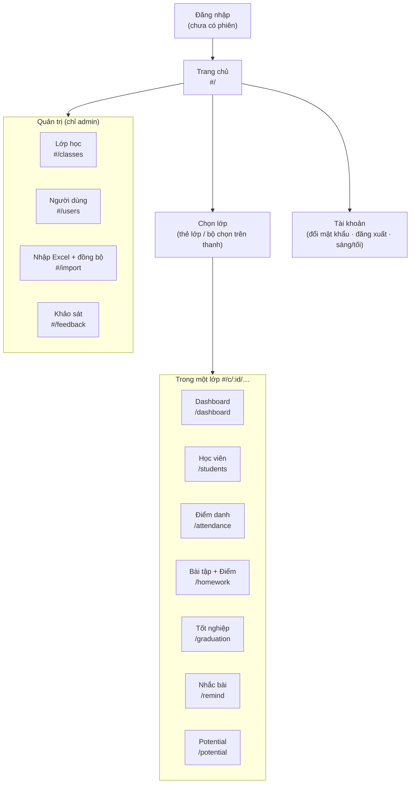

# Sitemap — Class Manager

Bản đồ các màn hình, địa chỉ (hash route) và ai được vào. Ứng dụng là trang đơn (SPA): mọi địa chỉ dạng `#/...` nằm sau `https://<tên-miền>/`.

Xem thêm: [user-flow.md](user-flow.md) (luồng thao tác) · [wireframe.md](wireframe.md) (bố cục từng màn hình) · [../DESIGN.md](../../DESIGN.md) (thiết kế tổng thể).

## 1. Sơ đồ



## 2. Danh sách màn hình

| # | Màn hình | Địa chỉ | Ai vào được | Mục đích |
|---|---|---|---|---|
| 0 | Đăng nhập | (tự hiện khi chưa đăng nhập) | Mọi người | Vào hệ thống bằng email + mật khẩu |
| 1 | Trang chủ | `#/` | Mọi tài khoản | Lớp đang hoạt động, lớp sắp khai giảng, số liệu tổng quan |
| 1b | Lịch | `#/schedule` | Mọi tài khoản (lớp mình có quyền) | Lịch dạng tháng (đủ các ngày, tuần từ T2): khai giảng + buổi học theo thứ học; bấm một ngày xem chi tiết (ca, chương trình, B2C/B2B, hình thức); chọn tháng |
| 2 | Dashboard lớp | `#/c/:id/dashboard` | Người có quyền vào lớp | Chuyên cần/điểm TB, biểu đồ, học viên cần chú ý |
| 3 | Học viên | `#/c/:id/students` | Như trên | Danh sách, sửa, thêm, xuất CSV, lịch sử thay đổi |
| 4 | Điểm danh | `#/c/:id/attendance` | Như trên (khách chỉ xem) | Điểm danh từng buổi, "cả lớp ✓" |
| 5 | Bài tập | `#/c/:id/homework` | Như trên (khách chỉ xem) | Trạng thái nộp HW/Capstone; mục Điểm bài tập |
| 6 | Tốt nghiệp | `#/c/:id/graduation` | Như trên | Gợi ý đủ điều kiện, đặt kết quả, công bố |
| 7 | Nhắc bài | `#/c/:id/remind` | Không dành cho khách | Thẻ tiến độ, tin nhắn, tổng quan, chế độ chụp |
| 8 | Potential | `#/c/:id/potential` | Admin + tài khoản được bật "Xem Potential" | Người chưa thanh toán / đã bị xóa khỏi sheet |
| 9 | Lớp học | `#/classes` | Admin | Danh sách/tạo lớp, lọc theo chương trình/giai đoạn |
| 10 | Người dùng | `#/users` | Admin | Tạo tài khoản, phân lớp, bật quyền, nhật ký đăng nhập |
| 11 | Nhập Excel | `#/import` | Admin | Nhập tay (chạy thử → nhập thật), trạng thái đồng bộ Sheet |
| 12 | Khảo sát | `#/feedback` | Admin | Tổng hợp khảo sát sau khóa |

**Quy ước địa chỉ**
- `#/c/:id` hoặc không có tab → mở **Dashboard** của lớp đó.
- Địa chỉ không hợp lệ hoặc lớp không được phân → về lớp đầu tiên có quyền; chưa được phân lớp nào thì hiện thông báo "liên hệ admin".
- Trang quản trị mở bởi tài khoản không phải admin → rơi về lớp/trang chủ.

## 3. Thanh điều hướng

```
[Logo]  Trang chủ · Dashboard · Học viên · Điểm danh · Bài tập · Tốt nghiệp · Nhắc bài · Potential        [Lớp ▾] [🛡 ⬇ 💬 …quản trị] [☀/🌙] [A  🔑  ⎋]
```

| Thành phần | Điều kiện hiện |
|---|---|
| Các tab trong lớp | Luôn hiện khi đã chọn lớp |
| **Nhắc bài** | Ẩn với tài khoản khách và với lớp xem chỉ-xem |
| **Potential** | Chỉ admin và tài khoản có quyền xem Potential |
| Cụm biểu tượng quản trị (Lớp học, Người dùng, Nhập Excel, Khảo sát) | Chỉ admin |
| Bộ chọn lớp `[Lớp ▾]` | Mọi tài khoản; liệt kê lớp được phân (kèm lớp sắp khai giảng nếu có quyền xem) |
| Nút chìa khóa (đổi mật khẩu) | Ẩn với khách |

Dưới 1300px chỉ hiện biểu tượng (không chữ); dưới 900px thanh tab xuống hàng riêng, cuộn ngang.

## 4. Cây chức năng trong từng màn hình

```
Trang chủ
├─ Hero: tiêu đề động + số liệu đếm lên
├─ Lớp đang hoạt động (băng chuyền: đang học → nộp/chấm bài → công bố tốt nghiệp)
└─ Lớp sắp khai giảng

Dashboard lớp
├─ Thẻ tổng quan (chuyên cần TB, Điểm TB, đang học, cần chú ý)
├─ 6 ô số liệu
├─ Biểu đồ: Điểm danh theo buổi · Nộp bài tập · Hình thức học
├─ (admin) Hồ sơ lớp từ phiếu đăng ký · Khảo sát của lớp
├─ Học viên cần chú ý
└─ Lối tắt: Điểm danh · Học viên · Bài tập

Học viên
├─ Tìm / lọc trạng thái / lọc hình thức · Xuất CSV · + Thêm học viên
├─ Bảng: mã, họ tên, email, SĐT, hình thức, trạng thái (+ nhãn Sheet), điểm danh %, HW %, Điểm TB
├─ Sửa học viên (hộp thoại) · Gỡ khỏi lớp (admin, bắt buộc lý do)
└─ Lịch sử thay đổi của lớp (100 sự kiện gần nhất)

Điểm danh
├─ Chú thích · Tìm · Sắp xếp (cá nhân hóa)
└─ Bảng học viên × buổi: ô chọn trạng thái / ghi chú · "Cả lớp ✓" · "Bỏ tất cả" · tỉ lệ

Bài tập
├─ Bảng học viên × bài: ✓ đã nộp · ↻ nộp lại · ✗ thiếu · ★ challenge
└─ Điểm bài tập (thang 10): điểm từng HW, Module, Điểm TB, TB lớp  (ẩn với khách)

Tốt nghiệp
├─ Quy tắc đang áp dụng (số buổi tối thiểu · HW · Capstone) + trạng thái quy tắc
├─ Bảng gợi ý & quyết định · Áp dụng gợi ý · Xuất CSV
└─ (admin) Sửa quy tắc · Công bố / hủy công bố

Nhắc bài
├─ Từng học viên: thẻ ảnh · tin nhắn · Anh/Chị · tên gọi · sao chép · chế độ chụp
├─ Tổng quan lớp (không tên) · ngưỡng ẩn danh · chế độ chụp
└─ Nạp bảng homework từ Excel (dán): kiểm tra → áp dụng

Potential
└─ Bảng: mã, họ tên, email, SĐT, trạng thái Sheet, lý do, từ ngày

Lớp học (admin)   Tìm · lọc · Tạo lớp mới · bảng lớp
Người dùng (admin) Thêm người dùng · bảng quyền · Phân lớp · Khóa/Mở khóa · Nhật ký đăng nhập
Nhập Excel (admin) Nhập đăng ký/lớp · nhập điểm danh+bài tập · trạng thái đồng bộ tự động
Khảo sát (admin)  Toàn trung tâm · theo lớp
```

## 5. Ma trận hiển thị theo vai trò

| Màn hình / khu vực | Admin | Giảng viên | Giảng viên + quyền Nhắc bài | Giảng viên + Xem lớp chưa diễn ra | Giảng viên + Xem Potential | Khách |
|---|---|---|---|---|---|---|
| Trang chủ, Dashboard, Học viên, Điểm danh, Bài tập, Tốt nghiệp | ✓ | ✓ (lớp được phân) | ✓ | ✓ (+ lớp sắp khai giảng, chỉ xem) | ✓ | ✓ (chỉ xem) |
| Điểm bài tập, cột Điểm TB | ✓ | ✓ | ✓ | ✓ | ✓ | ✗ |
| Nhắc bài (tin nhắn, ảnh, chụp) | ✓ | thẻ tiến độ | ✓ | thẻ tiến độ | thẻ tiến độ | ✗ (ẩn tab) |
| Potential | ✓ | ✗ | ✗ | ✗ | ✓ | ✗ |
| Quản trị (Lớp học, Người dùng, Nhập Excel, Khảo sát) | ✓ | ✗ | ✗ | ✗ | ✗ | ✗ |
