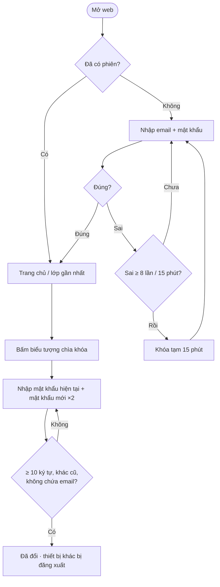
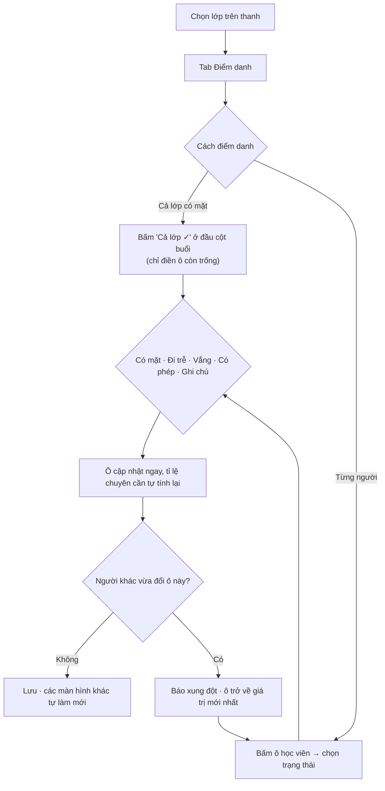
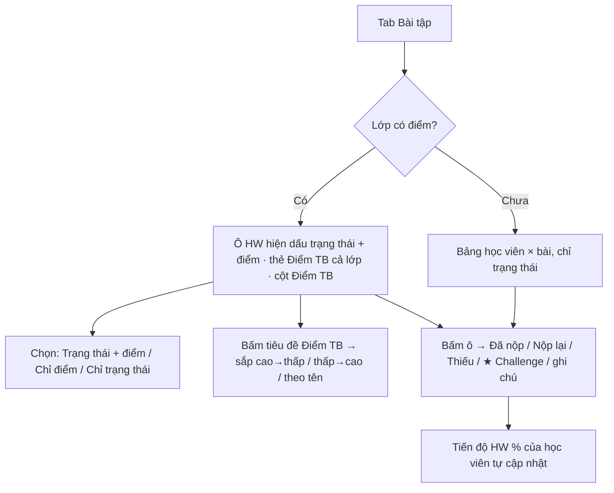
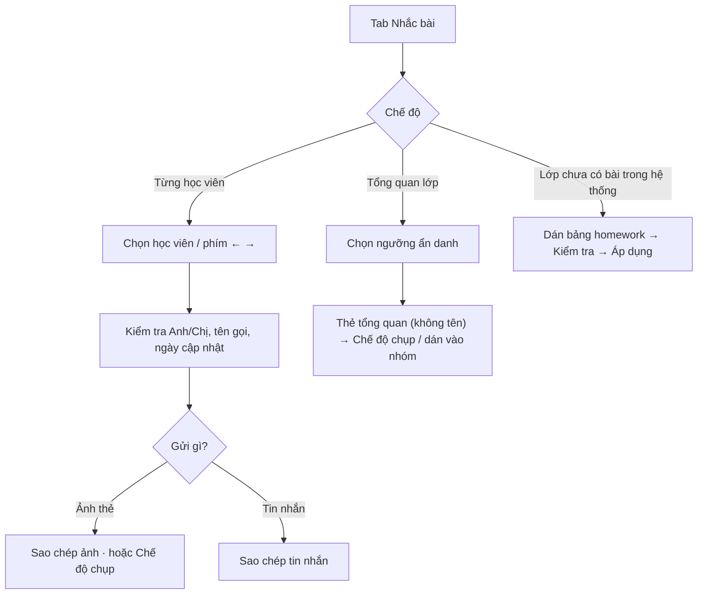
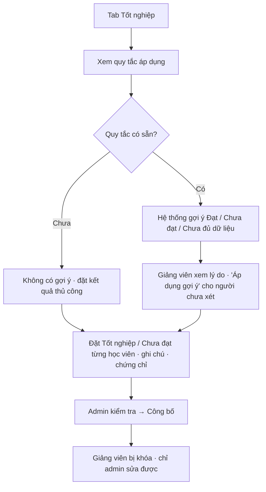
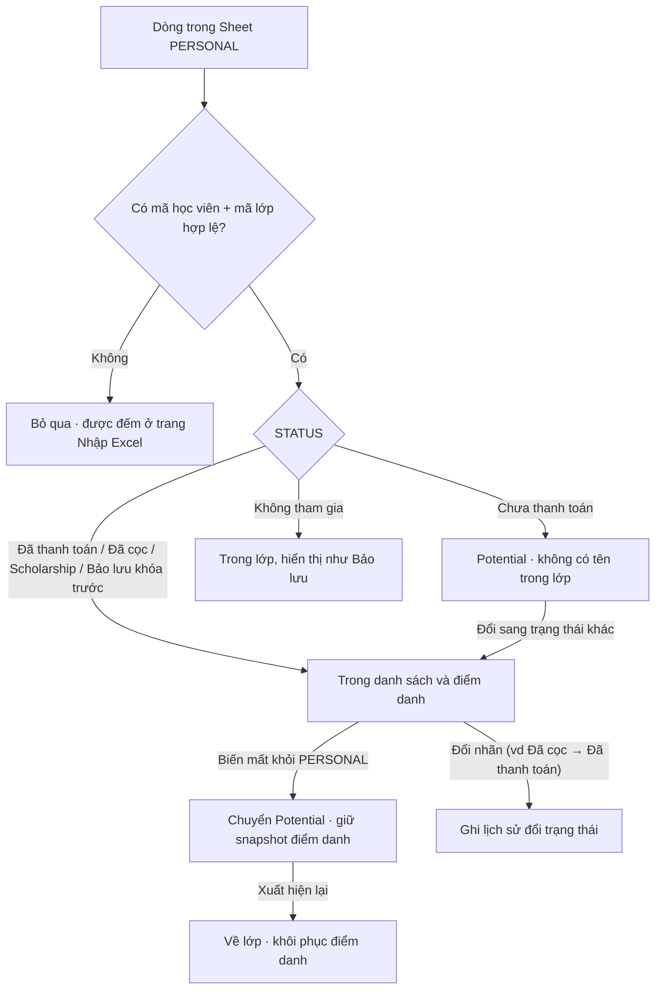
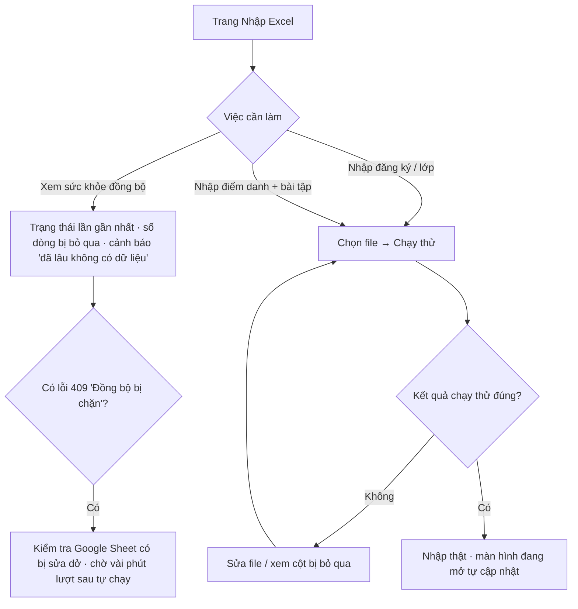
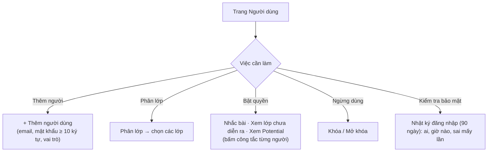
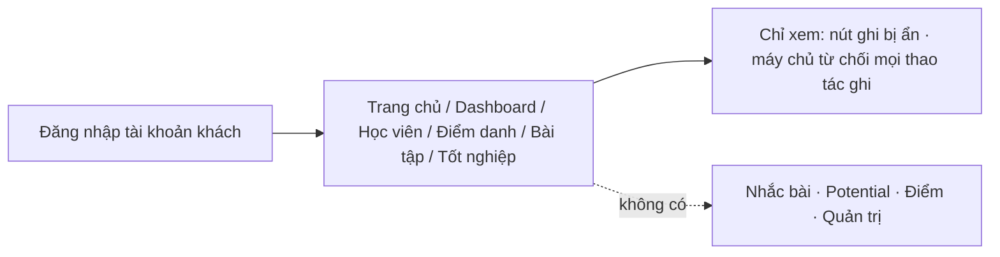
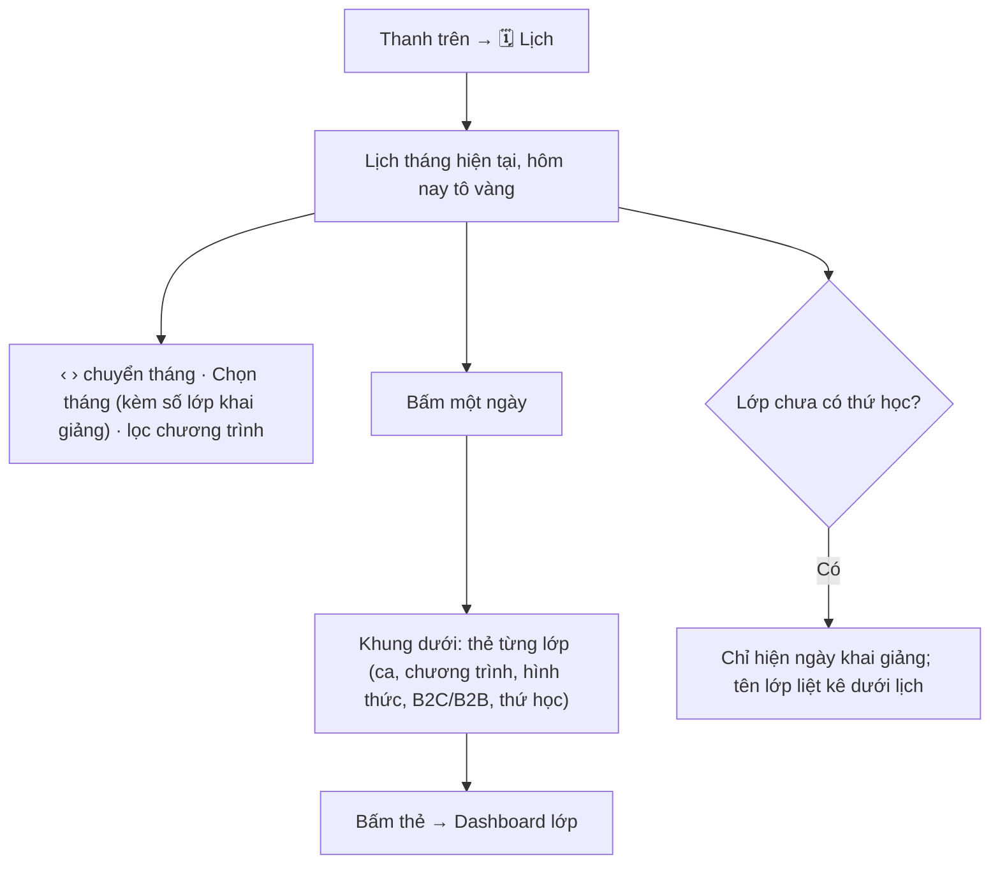

# User flow — Class Manager

Các luồng thao tác chính theo từng người dùng. Mỗi luồng gồm: **ai**, **mục tiêu**, **các bước**, **ngoại lệ**.
Xem thêm: [sitemap.md](sitemap.md) · [wireframe.md](wireframe.md) · [../DESIGN.md](../../DESIGN.md).

## Mục lục
1. [Người dùng và mục tiêu](#1-người-dùng-và-mục-tiêu)
2. [Đăng nhập, đổi mật khẩu](#2-đăng-nhập-đổi-mật-khẩu)
3. [Điểm danh một buổi](#3-điểm-danh-một-buổi)
4. [Theo dõi bài tập và điểm](#4-theo-dõi-bài-tập-và-điểm)
5. [Nhắc bài học viên](#5-nhắc-bài-học-viên)
6. [Danh sách tốt nghiệp](#6-danh-sách-tốt-nghiệp)
7. [Học viên từ Google Sheet vào lớp (luồng hệ thống)](#7-học-viên-từ-google-sheet-vào-lớp-luồng-hệ-thống)
8. [Admin: xử lý cảnh báo và nhập dữ liệu](#8-admin-xử-lý-cảnh-báo-và-nhập-dữ-liệu)
9. [Admin: quản lý người dùng và quyền](#9-admin-quản-lý-người-dùng-và-quyền)
10. [Khách: chỉ xem](#10-khách-chỉ-xem)
11. [Xem lịch khai giảng và giảng dạy](#11-xem-lịch-khai-giảng-và-giảng-dạy)

---

## 1. Người dùng và mục tiêu

| Người dùng | Mục tiêu chính | Thao tác thường gặp |
|---|---|---|
| **Giảng viên** | Điểm danh, chấm/ghi nhận bài, biết ai cần nhắc | Điểm danh, cập nhật HW, xem Dashboard |
| **Giảng viên có quyền Nhắc bài** | Nhắc học viên làm bài hàng loạt | Sao chép tin nhắn/ảnh, gửi tổng quan |
| **Giảng viên có quyền xem lớp chưa diễn ra / Potential** | Chuẩn bị lớp mới, theo dõi người chưa vào lớp | Xem lớp sắp khai giảng, danh sách Potential |
| **Admin** | Giữ dữ liệu đúng, phân quyền, công bố tốt nghiệp | Nhập/đối soát, quản lý người dùng, công bố |
| **Khách** | Xem số liệu | Xem Dashboard, danh sách |

---

## 2. Đăng nhập, đổi mật khẩu

**Ai:** mọi người · **Mục tiêu:** vào hệ thống an toàn.

**Ngoại lệ:** tài khoản bị khóa (admin) → không đăng nhập được; khách không có nút đổi mật khẩu.

---

## 3. Điểm danh một buổi

**Ai:** giảng viên của lớp, admin · **Mục tiêu:** ghi nhận chuyên cần nhanh, không ghi đè nhầm người khác.

**Ghi chú:** `✓` có mặt · `T` đi trễ · `V` vắng · `P` có phép · `·` chưa điểm danh. Ô chưa điểm danh của buổi đã diễn ra tính là **vắng**; vắng có phép được **nửa buổi** (vẫn nằm trong mẫu số). Bấm "Bỏ tất cả" để xóa điểm danh của một buổi.

---

## 4. Theo dõi bài tập và điểm

**Ai:** giảng viên, admin · **Mục tiêu:** biết ai đã nộp, điểm bao nhiêu.

Điểm đến từ **Google Sheet bảng điểm** (tự đồng bộ), giảng viên **không nhập tay** trên web. Điểm không làm đổi trạng thái nộp bài.

---

## 5. Nhắc bài học viên

**Ai:** admin + giảng viên có quyền Nhắc bài · **Mục tiêu:** gửi nhắc cá nhân hoặc báo cáo chung cho cả lớp.

**Người không có quyền** chỉ thấy thẻ tiến độ của từng học viên: không có tin nhắn, không có nút sao chép/chụp, không có tổng quan.

---

## 6. Danh sách tốt nghiệp

**Ai:** giảng viên của lớp đặt kết quả; admin công bố · **Mục tiêu:** chốt ai tốt nghiệp.

**Quy tắc số buổi** theo Quy định 003/2026: đạt khi `có mặt + vắng có phép ≥ tối thiểu` của chương trình. Đang học mà còn đủ buổi để đạt thì chưa kết luận. Điều kiện **điểm** chưa áp dụng (chờ quy trình từ chủ dự án).

---

## 7. Học viên từ Google Sheet vào lớp (luồng hệ thống)

**Ai:** hệ thống tự chạy (mỗi phút) · **Mục tiêu:** danh sách lớp luôn khớp Google Sheet vận hành.

**Lưu ý**
- **COMPANY (B2B)** không áp dụng Potential: học bình thường dù "Chưa thanh toán"; biến mất chỉ cảnh báo.
- Một lượt Sheet có thay đổi bất thường (thêm/chuyển > 5% hoặc 100 người) bị **từ chối cả lượt**, dữ liệu giữ nguyên.
- Học viên admin đã "Gỡ khỏi lớp" không bị tự thêm lại.

---

## 8. Admin: xử lý cảnh báo và nhập dữ liệu

**Ai:** admin · **Mục tiêu:** dữ liệu đúng, biết khi đồng bộ có vấn đề.

---

## 9. Admin: quản lý người dùng và quyền

**Ai:** admin · **Mục tiêu:** cấp đúng quyền cho đúng người.

Người mới nhận mật khẩu tạm qua kênh riêng và **tự đổi** bằng biểu tượng chìa khóa.

---

## 10. Khách: chỉ xem

**Ai:** tài khoản khách · **Mục tiêu:** xem số liệu mà không thể sửa.

---

## 11. Xem lịch khai giảng và giảng dạy

**Ai:** mọi tài khoản (mỗi người chỉ thấy lớp mình có quyền) · **Mục tiêu:** biết hôm nào lớp nào khai giảng, hôm nào lớp nào học.

Bế giảng và giảng viên từng buổi: chờ chủ dự án gửi dữ liệu.
